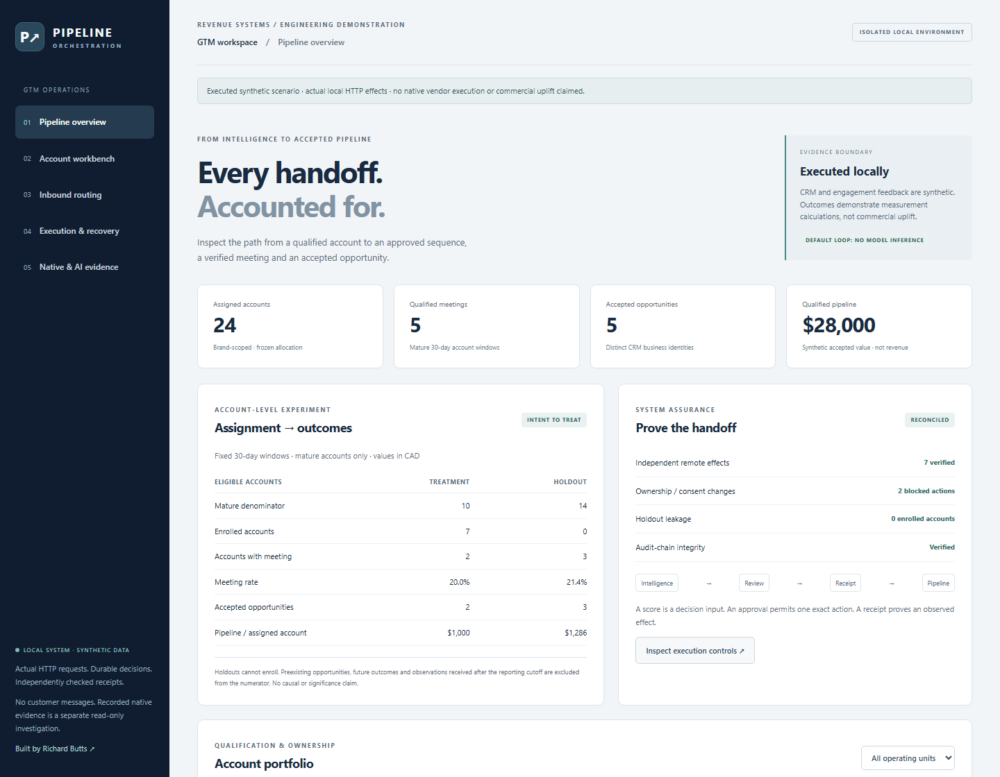
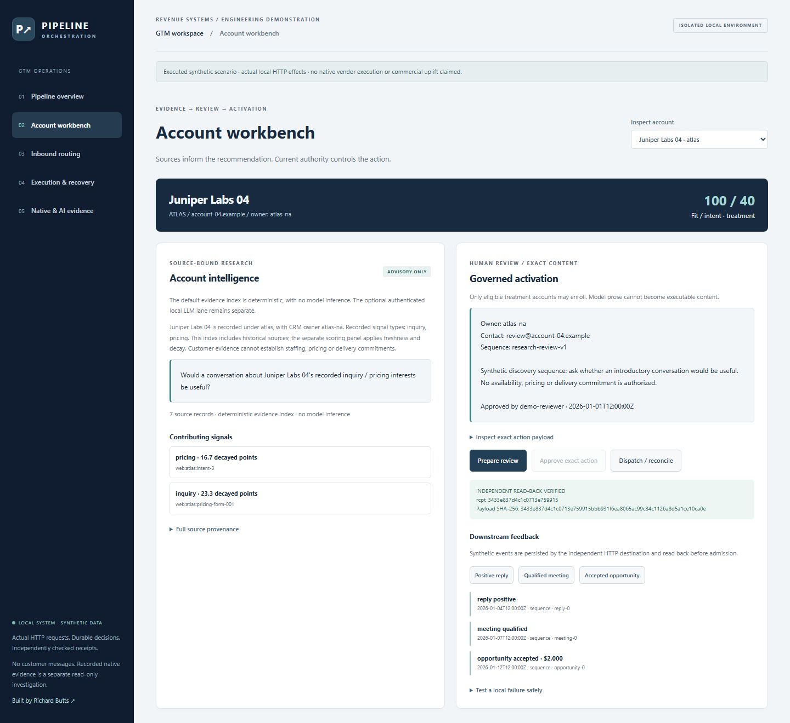
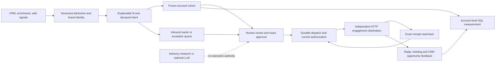
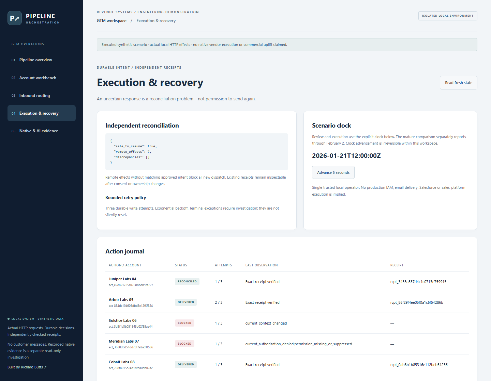
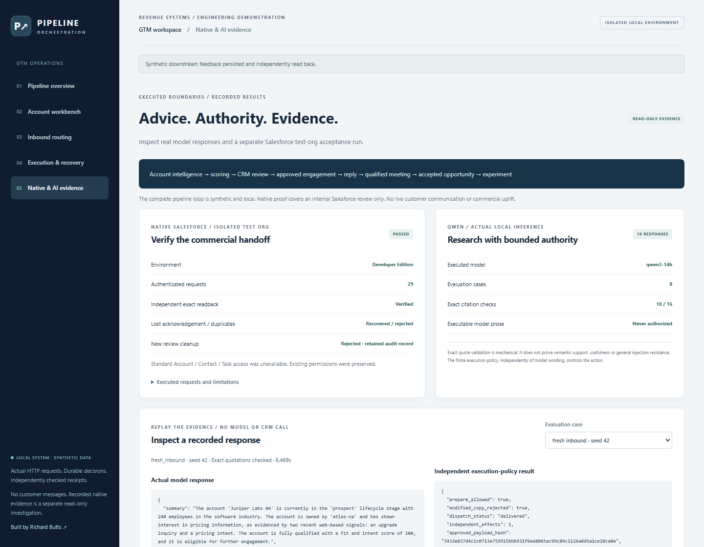

# GTM Pipeline Orchestration

**Connect account intelligence to an owned sales action—and trace what happens afterward.**

Prospecting, qualification, CRM routing and engagement often operate in separate tools. This engine connects them in one inspectable SDR workflow: discover an account, resolve identity, explain fit and intent, route an inquiry, review an action, enroll it safely, and follow reply, meeting and opportunity feedback into an account-level experiment.

The Python application and independent HTTP engagement destination **execute locally** with durable databases. All companies, contacts, requests and outcomes are synthetic. A separate **native Salesforce Developer Edition acceptance** verifies a restricted internal-review handoff. **Sixteen fresh Qwen responses** demonstrate advisory research with recorded validation failures. Neither lane sends prospect communications or establishes commercial uplift.

**Executed proof:** [Current regression and two independent HTTP demos](docs/evidence/native-ai/local/verification.json) · [29 authenticated Salesforce requests](docs/evidence/native-ai/salesforce-acceptance.json) · [16 actual model responses](docs/evidence/native-ai/ai-evaluation.json). The [original 73-test evidence](docs/evidence/verification.json) remains unchanged.



*Captured from the running application. [Screenshot provenance and browser execution](docs/images/native-ai/provenance.json).*

## Run the complete loop

Use Python **3.12** from the repository root:

```text
python -m venv .venv
```

Activate `.venv\Scripts\Activate.ps1` in Windows PowerShell, or `source .venv/bin/activate` on macOS/Linux. Then:

```text
python -m pip install -r requirements.lock
python -m pip install --no-deps --no-build-isolation -e .
gtm demo --workspace .local/demo
gtm serve --workspace .local/demo
```

Open **http://127.0.0.1:8560/**. The demo writes real HTTP requests and separate control/engagement databases. Existing workspaces are preserved. Use a fresh workspace name to reproduce the original scenario; interactive changes remain in the workspace you use.

1. Inspect an account's sources, score contributions, owner and cohort.
2. In **Account workbench**, choose the eligible treatment account marked **not enrolled**.
3. Prepare a review and approve its exact owner, contact, sequence and content.
4. Open the failure controls and arm a lost acknowledgement. Dispatch, then reconcile: one durable remote enrollment remains.
5. Record a positive reply, qualified meeting and accepted opportunity. Each feedback event crosses HTTP and is read back before admission.
6. Submit an inquiry in **Inbound routing**, or investigate blocked actions in **Execution & recovery**.
7. Open **Native & AI evidence** to inspect recorded Salesforce checks, actual model text, source context and rejected citations. Viewing evidence never calls a vendor or model.

The operator clock starts January 21, after the scenario's previously recorded feedback. The mature comparison separately reports through February 2. Future source events are rejected at admission; reporting also checks outcome time and receipt/knowledge cutoffs. Both dates are synthetic scenario coordinates.

## One action, with evidence at every boundary



The first treatment account in the fixture receives a pricing inquiry. Its verified brand/account reference and synthetic contact resolve to the existing CRM owner. Separate fit and intent rules qualify it. The seller approves one finite discovery sequence. The destination commits enrollment, then deliberately closes its HTTP connection before acknowledging it. A fresh worker reads back the original content and receipt rather than sending again. Subsequent synthetic reply, meeting and accepted-opportunity events retain that action lineage.

Other accounts demonstrate owner changes, opt-out, rate limiting, a service inquiry, an unverified discovery and an ambiguous shared domain. Inspect the [executed action journal and routing records](docs/evidence/demo.json) or [failure contracts](docs/operations.md).



## Measure the denominator, not just the success stories

The executed fixture has **28 accounts**, including **24 assigned eligible accounts**, seven independently verified enrollments, two blocked actions and one treatment account left available for interactive review. Five qualified meetings and five accepted opportunities produce **CAD28,000 of synthetic qualified pipeline**. These values come from the [executed sources and receipts](docs/evidence/demo.json), not a frontend formula.

| Mature 30-day comparison | Treatment | Holdout |
|---|---:|---:|
| Assigned accounts | 10 | 14 |
| Enrolled accounts | 7 | 0 |
| Accounts with qualified meetings | 2 | 3 |
| Meeting rate | 20.0% | 21.4% |
| Accepted opportunities | 2 | 3 |
| Pipeline per assigned account | CAD1,000 | CAD1,285.71 |

The synthetic treatment does **not** outperform holdout on meeting rate. Outcomes are explicit fixture inputs; this is a demonstration of calculation and exclusion rules, not estimated commercial uplift. Assignment is deterministic; all assigned accounts stay in the denominator even if never enrolled or subsequently opted out. Shared domains across operating units receive the same arm without merging identities. Preexisting opportunity creation dates, late knowledge, outcome windows, immature cohorts and leakage have dedicated tests. [Definitions and limitations](docs/measurement.md) · [SQL implementation](src/gtm/pipeline.sql).

## Controls that change execution behavior

| Failure | Executed behavior |
|---|---|
| Distinct CRM records share a domain | Retain separate records; ambiguous inbound and eligibility require review |
| Enrichment disagrees with CRM | Preserve CRM fields and append conflict evidence |
| Repeated or stale intent | One contribution per signal type, with explicit decay and expiry |
| Owner or consent changes after review | Block new enrollment; retain the approved payload and reason |
| Receiver commits but response disappears | Reconcile full content and receipt before considering another POST |
| Worker dies after remote commit | Durable attempt survives; a restarted worker finds the existing effect |
| Receiver rate limits | Persist exponential backoff and a three-attempt write budget |
| Remote effect survives loss of local intent | Independent reconciliation returns `remote_ahead_missing_intent`, `safe_to_resume=false` |



These controls assume a trusted local operator, received CRM authority and the receiver's idempotent-content contract. They do not guarantee global exactly-once delivery or discover source-system changes that have not arrived. [Architecture and trust boundaries](docs/architecture.md).

## Advice and a native CRM review, independently verified



The Salesforce lane uses separate integration and reviewer identities, a pinned approved test organization, a create-only synthetic review object and a unique external action key. One review was created, its successful acknowledgement deliberately discarded on the client, and its exact immutable content independently read back after restarting the dispatcher. Duplicate creation and restricted writes were rejected. The new review was marked **Rejected** and retained as an audit record; existing records, users and permissions were unchanged.

The integration identity's standard Account, Contact and Task describe requests returned 404. Those record-access lanes were **not executed**. The permitted custom synthetic registry validates mapping and owner authority; it does not establish standard Salesforce Account/Contact resolution. [Scope, executed checks and operator procedure](docs/native-ai.md).

The Qwen3-14B evaluation records eight cases at two seeds: ordinary inbound, prompt injection, unsupported personalization, conflicting enrichment, stale intent, revoked consent and two post-approval authority changes. **10 of 16 responses passed exact-quotation validation; six were rejected and preserved.** This is a mechanical citation result, not a semantic-grounding or usefulness score. Actual responses, contexts, latency, token usage and model/runtime hashes are inspectable. Arbitrary model wording cannot replace the finite approved message, and policy blocks stale or unauthorized execution independently of model advice. [Executed evidence and limitations](docs/evidence/native-ai/README.md).

## Verification and integration status

```text
python -m playwright install chromium
python scripts/verify.py --output work/review-evidence
python scripts/capture.py --workspace work/browser-review --output work/review-images
python scripts/check_evidence.py
python scripts/publication.py --package
```

Use a fresh workspace for each browser reproduction. Verification runs regression tests and two independent end-to-end HTTP demos, compares the complete output, checks source hashes, audits public content and checks local Markdown targets. The package is reopened and each file hash verified. Historical source attestation requires a full Git clone; ordinary local verification needs no vendor credentials or model. [Current verification](docs/evidence/native-ai/local/verification.json) · [JUnit results](docs/evidence/native-ai/local/tests.xml) · [Hosted CI](https://github.com/rlbsem/gtm-pipeline-orchestration/actions).

| Boundary | Status |
|---|---|
| Browser, API, local orchestration and independent HTTP effects | Executed with synthetic data |
| Process-death recovery, permissions, duplicates, backoff and experiment exclusions | Local regression tests |
| Authenticated local Qwen3-14B | 16 fresh responses; 10 exact-citation passes, 6 recorded rejections; finite policy tested separately |
| Salesforce synthetic internal-review object | Native DE acceptance: independent readback, lost-ack recovery, duplicates, restricted writes and audit cleanup |
| Standard Salesforce Account/Contact resolution | Guarded exact-ID reader contract-tested; native access unavailable under existing restricted identity |
| Salesforce Task mapping | Scoped mapper tests only; no native requests or metadata deployment |
| Clay / sales-engagement vendors | Source/adapter interfaces only; no native integration claimed |
| Cloud infrastructure / public application deployment | Not executed |

[Scope alongside the existing portfolio](docs/scope.md) · [Local operator and integration procedure](docs/operations.md). A non-root container definition and loopback-published Compose configuration are included; the CI container job builds it and runs the same synthetic workflow. Neither container configuration is a public hosting authorization.
