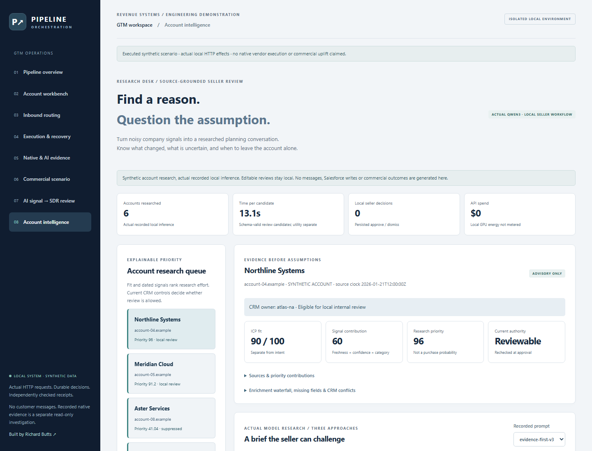
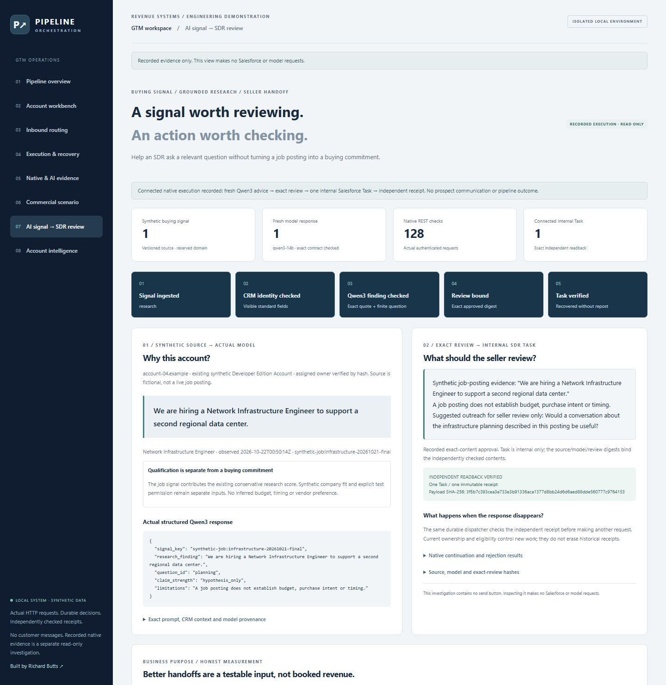
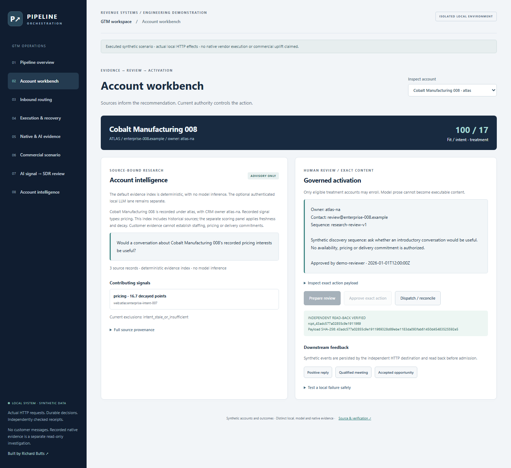
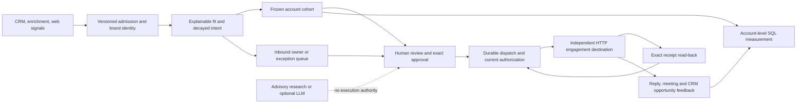
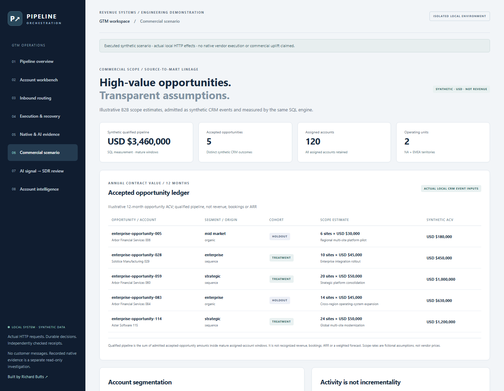
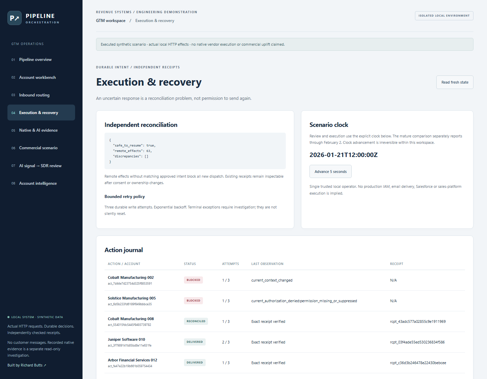
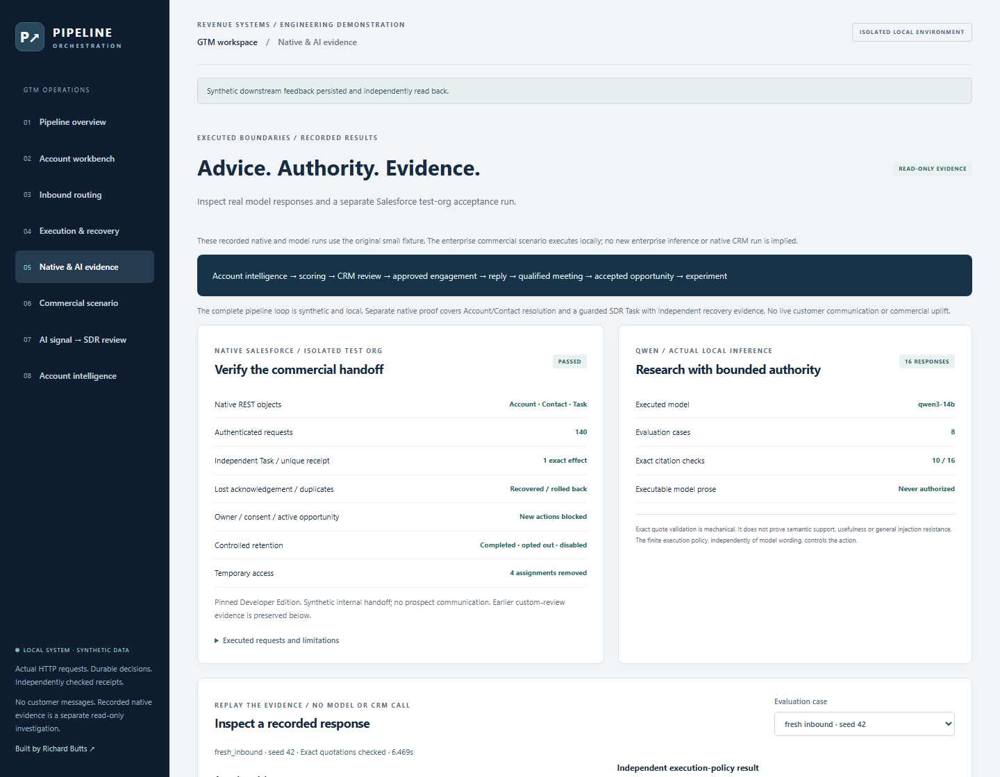

# GTM Pipeline Orchestration

**Connect account intelligence to an owned sales action, then trace what happens afterward.**

**Business impact:** Turn fragmented sales intelligence and manual handoffs into accountable, traceable qualified-pipeline execution. Teams can see why an account is prioritized, who owns the next action, what was approved and which opportunities resulted. This engine connects prospecting, qualification, CRM routing and engagement in one inspectable SDR workflow, from research and owner routing through reviewed actions and opportunity feedback.

The Python application and independent HTTP engagement destination **execute locally** with durable databases. All sales-workflow companies, contacts, requests and outcomes are synthetic; the public job API sample is a separate read-only archive. A **connected native acceptance run** takes a versioned buying signal and actual Salesforce context through fresh Qwen3 inference, exact operator review, one internal SDR Task and independent readback. Earlier Salesforce acceptance and the sixteen-response model evaluation remain separately inspectable. Native Salesforce acceptance verifies a guarded internal Task and independent readback; separate local execution demonstrates controlled engagement processing and source-to-pipeline measurement.

The primary enterprise B2B profile covers **120 accounts and USD $3.46M of synthetic accepted-opportunity pipeline**, calculated from five CRM outcome events. The earlier deterministic CAD regression scenario remains preserved. The USD opportunity estimates are independently generated for the synthetic enterprise case.

**Account intelligence desk:** prioritize six synthetic accounts, inspect dated multi-source evidence and enrichment conflicts, compare actual Qwen3 research, edit an opening and record an exact local seller decision. Forty recorded responses across three prompt approaches retain citation failures, stale-signal mistakes and conservative abstentions. Rich research remains separate from the earlier native Task and commercial measurement runs. [Research architecture, evaluation and limits](docs/account-intelligence.md) · [Actual responses](docs/evidence/research/evaluation.json) · [Reviewer assessment](docs/evidence/research/reviewer-assessment.json).



*Captured from the running application; [desktop/mobile execution and screenshot hashes](docs/images/current-research/provenance.json).*

**Executed proof:** [Current regression and four independent HTTP demos](docs/evidence/research/local/verification.json) · [Connected model-to-Task execution: 128 native requests](docs/evidence/connected/acceptance.json) · [140 native standard-object requests](docs/evidence/salesforce-standard/acceptance.json) · [20 independent post-cleanup checks](docs/evidence/salesforce-standard/post-cleanup.json) · [16 actual model responses](docs/evidence/native-ai/ai-evaluation.json). The original [73-test](docs/evidence/verification.json), [127-test enterprise](docs/evidence/enterprise/verification.json) and [29-request custom-review](docs/evidence/native-ai/salesforce-acceptance.json) evidence remains unchanged.



*Captured from the running application. [Current screenshot provenance and browser execution](docs/images/current-presentation/provenance.json). Earlier captures remain unchanged..*

**Engineering Evidence Lab:** [Explore the recorded SDR research](https://rlbsem.github.io/enterprise-revenue-systems-lab/?case=gtm-research) · [Inspect the synthetic qualified-pipeline case](https://rlbsem.github.io/enterprise-revenue-systems-lab/?case=gtm-enterprise) · [Review the Lab source](https://github.com/rlbsem/enterprise-revenue-systems-lab). These read-only investigations preserve separate provenance for the research desk, native Salesforce acceptance and synthetic opportunity measurement. The connected Qwen3-to-native-Task run is documented below and in [execution evidence](docs/connected-sdr.md).

## Run the complete loop locally

**No-install option:** [Explore the recorded GTM and AI evidence in the hosted Engineering Evidence Lab](https://rlbsem.github.io/enterprise-revenue-systems-lab/). It is a public, read-only presentation of saved runs, not a live instance of this application.

To run the interactive application on your own computer, use Python **3.12** from the repository root:

```text
python -m venv .venv
```

Activate `.venv\Scripts\Activate.ps1` in Windows PowerShell, or `source .venv/bin/activate` on macOS/Linux. Then:

```text
python -m pip install -r requirements.lock
python -m pip install --no-deps --no-build-isolation -e .
gtm demo --profile enterprise --workspace .local/enterprise-usd-v2
gtm serve --profile enterprise --workspace .local/enterprise-usd-v2
```

Once `gtm serve` is running, open `http://127.0.0.1:8560/` in a browser on the **same computer**. This is the locally running operator interface, not a publicly hosted site. The demo writes real HTTP requests and separate control/engagement databases. Existing workspaces are preserved. Legacy enterprise workspaces are rejected rather than relabeled; use the fresh USD v2 directory above. Use a fresh workspace name to reproduce the scenario; interactive changes remain in the workspace you use.

1. Inspect an account's sources, score contributions, owner and cohort.
2. In **Account workbench**, choose the eligible treatment account marked **not enrolled**.
3. Prepare a review and approve its exact owner, contact, sequence and content.
4. Open the failure controls and arm a lost acknowledgement. Dispatch, then reconcile: one durable remote enrollment remains.
5. Record a positive reply, qualified meeting and accepted opportunity. Each feedback event crosses HTTP and is read back before admission.
6. Submit an inquiry in **Inbound routing**, or investigate blocked actions in **Execution & recovery**.
7. Open **Native & AI evidence** to inspect recorded Salesforce checks, actual model text, source context and rejected citations. Viewing evidence never calls a vendor or model.
8. Open **Commercial scenario** to trace the five enterprise opportunity values to their scope assumptions, CRM sources and account segments.
9. Open **AI signal → SDR review** to inspect the fresh connected Qwen3-to-Salesforce run, exact reviewed content, independent receipt and rejection results. This view is read-only.
10. Open **Account intelligence** to compare actual research approaches, inspect supporting sources, edit a draft, and approve or dismiss locally. These decisions cannot create Salesforce Tasks or send communications.

The operator clock starts January 21, after the scenario's previously recorded feedback. The mature comparison separately reports through February 2. Future source events are rejected at admission; reporting also checks outcome time and receipt/knowledge cutoffs. Both dates are synthetic scenario coordinates.

## From a buying signal to a verified internal Task

A fictional infrastructure job posting suggests a reason for an SDR to ask a question, not proof of buying intent. The connected lane matches an existing pinned synthetic Salesforce Account/Contact, retrieves its actual visible CRM context, invokes Qwen3, validates its exact quotation and bounded question, and binds the operator-approved brief to one native internal Task.

**What actually ran:** six read-only context requests, fresh Qwen3-14B inference, five native Apex tests and a 128-request Salesforce continuation. Independent reviewer readback verified the Task contents, Account/Contact association, owner, creator and immutable receipt. A deliberately lost acknowledgement recovered without reposting. Duplicate, unsupported-content, owner-change, opt-out and reviewer-create probes were rejected. Cleanup completed the Task, restored the original disabled/opted-out flags and removed four temporary grants.

The model selects from a finite question catalog; it does not perform unrestricted research or authorize CRM writes. The source and company fit are synthetic, and the internal Task sends nothing. The synthetic USD $3.46M opportunity scenario independently demonstrates qualified-pipeline measurement, while the native Task execution has its own separate acceptance evidence. [Executed source, model and review](docs/evidence/connected/preview.json) · [Native readback and failure checks](docs/evidence/connected/acceptance.json) · [Architecture, limitations and reproduction](docs/connected-sdr.md).

## One action, with evidence at every boundary



The enterprise fixture routes six pricing inquiries to their existing CRM owners. Its verified brand/account reference and synthetic contact resolve to the existing CRM owner. Separate fit and intent rules qualify it. The seller approves one finite discovery sequence. One independent destination request commits enrollment, then deliberately closes its HTTP connection before acknowledging it. A fresh worker reads back the original content and receipt rather than sending again. Subsequent synthetic reply, meeting and accepted-opportunity events retain that action lineage.

The enterprise workflow retains owner-change, opt-out and rate-limit failures. The small regression fixture additionally preserves service, unverified-discovery and ambiguous-domain cases. Inspect the [executed enterprise journal and routing records](docs/evidence/enterprise-usd/demo.json) or [failure contracts](docs/operations.md).



## Measure the denominator, not just the success stories

The primary enterprise demonstration has **120 synthetic accounts**: 48 mid-market, 48 enterprise and 24 strategic accounts, spanning three industries, two operating units and NA/EMEA territories. The unchanged account allocation produces 66 treatment and 54 holdout accounts. Sixty-three enrollments have exact independent receipts; two actions are blocked and one treatment account remains available for interactive review. Twelve qualified meetings lead to **five accepted opportunities and USD $3,460,000 of synthetic qualified pipeline**.

The five synthetic CRM outcomes carry annual contract value estimates of **USD $180,000, USD $450,000, USD $1,000,000, USD $630,000 and USD $1,200,000**. Their illustrative site scopes and unit assumptions are [versioned fixture inputs](src/gtm/enterprise-scenario.json). Amounts enter actual `source/v1` CRM outcome events, cross the local feedback HTTP boundary and pass through the existing SQL measurement engine. A separate Python source-event traversal independently reconciles amounts, counts and readback. [Executed source events, financial audit and lineage](docs/evidence/enterprise-usd/demo.json).



| Mature 30-day comparison | Treatment | Holdout |
|---|---:|---:|
| Assigned accounts | 66 | 54 |
| Enrolled accounts | 63 | 0 |
| Accounts with qualified meetings | 7 | 5 |
| Meeting rate | 10.6% | 9.3% |
| Accepted opportunities | 3 | 2 |
| Synthetic pipeline | USD $2,650,000 | USD $810,000 |
| Pipeline per assigned account | USD $40,151.52 | USD $15,000 |

Outcome accounts and scopes are specified independently of allocation. Their unequal distribution and concentrated deal values are fixture arithmetic, **not evidence of incremental pipeline, AI lift or causal improvement**. All assigned accounts remain in the denominator, including unactivated and later-blocked accounts. The holdout receives organic outcomes without enrollment. These are accepted opportunity estimates, not realized revenue, signed bookings, ARR, vendor prices or actual client results. [Definitions and limitations](docs/measurement.md) · [Currency-checked SQL implementation](src/gtm/pipeline.sql).

The original **28-account / CAD28,000** scenario remains unchanged for regression and failure recovery:

```text
gtm demo --profile fixture --workspace .local/regression-01
```

Historical CAD enterprise snapshots and original native/model records remain unchanged in the [evidence archive](docs/evidence/archive.md).

Its complete output is compared against the [original recorded fixture](docs/evidence/demo.json) during every verification. Existing workspaces retain their original profile; use a fresh enterprise workspace rather than overwriting one. [Scenario assumptions and evidence](docs/evidence/enterprise-usd/README.md).

## Controls that change execution behavior

| Failure | Executed behavior |
|---|---|
| Distinct CRM records share a domain | Retain separate records; ambiguous inbound and eligibility require review |
| Enrichment disagrees with CRM | Preserve CRM fields and append conflict evidence |
| Repeated or stale intent | One contribution per signal type, with explicit decay and expiry |
| Owner or consent changes after review | Block new enrollment; retain the approved payload and reason |
| Receiver commits but response disappears | Reconcile full content and receipt before considering another POST |
| Worker dies after remote commit | Durable attempt survives; a restarted worker finds the existing effect |
| Receiver rate limits | Persist exponential backoff and a three-attempt write budget |
| Remote effect survives loss of local intent | Independent reconciliation returns `remote_ahead_missing_intent`, `safe_to_resume=false` |



These controls assume a trusted local operator, received CRM authority and the receiver's idempotent-content contract. They do not guarantee global exactly-once delivery or discover source-system changes that have not arrived. [Architecture and trust boundaries](docs/architecture.md).

## Advice and a native SDR handoff, independently verified



The standard-object Salesforce lane resolves exact synthetic Account and Contact keys, preserves their owner and association, checks consent and open opportunities, and creates one internal SDR Task. An Apex guard creates its unique receipt in the same native transaction. After deliberately discarding the successful acknowledgement, a restarted dispatcher recovers the Task through the independent reviewer without another POST. An explicit duplicate probe rolls back the additional Task. Changed owner, revoked consent, wrong contact association and an open opportunity each reject new actions on both client and server.

Three native Apex tests and the REST run verify the guard and access boundaries. Cleanup retains the completed Task, opts out the Contact, disables the Account and closes the synthetic blocker Opportunity. Three temporary permission-set assignments and one integration entitlement assignment are removed. A separate read-only run confirms original access is restored and Task content and relationships remain intact. [Relationships, exact rejected responses and permissions](docs/evidence/salesforce-standard/native-details.json) · [Native procedure and limitations](docs/native-standard-crm.md).

The earlier 404s were traced to missing integration entitlement, object grants, Access Activities and field permissions, not unsupported Salesforce objects. The original restricted custom-review roles are preserved. Native runs use the original small fixture; the USD $3.46M enterprise pipeline remains an independently measured local synthetic scenario. The earlier [custom-review and model execution](docs/native-ai.md) is preserved separately. No native Outreach, Salesloft, prospect delivery or commercial result is claimed.

The Qwen3-14B evaluation records eight cases at two seeds: ordinary inbound, prompt injection, unsupported personalization, conflicting enrichment, stale intent, revoked consent and two post-approval authority changes. **10 of 16 responses passed exact-quotation validation; six were rejected and preserved.** This is a mechanical citation result, not a semantic-grounding or usefulness score. Actual responses, contexts, latency, token usage and model/runtime hashes are inspectable. Arbitrary model wording cannot replace the finite approved message, and policy blocks stale or unauthorized execution independently of model advice. [Executed evidence and limitations](docs/evidence/native-ai/README.md).

## Verification and integration status

```text
python -m playwright install chromium
python scripts/verify.py --output work/review-evidence
python scripts/capture.py --workspace work/browser-review --output work/review-images
python scripts/browser_audit_tools.py
python scripts/capture_research.py --workspace work/browser-research --output work/review-research-images --audit-tools work/audit-tools
python scripts/check_evidence.py --verification-record work/review-evidence/verification.json --browser-record work/review-images/provenance.json --research-images work/review-research-images
python scripts/publication.py --package
```

Use a fresh workspace for each browser reproduction. Verification runs regression tests and four independent end-to-end HTTP demos (two per profile), compares the complete output, checks source hashes, audits public content and checks local Markdown targets. The package is reopened and each file hash verified. Historical source attestation requires a full Git clone; ordinary local verification needs no vendor credentials or model. [Current verification](docs/evidence/current-presentation/local/verification.json) · [JUnit results](docs/evidence/current-presentation/local/tests.xml) · [Hosted CI](https://github.com/rlbsem/gtm-pipeline-orchestration/actions).

| Boundary | Status |
|---|---|
| Browser, API, local orchestration and independent HTTP effects | Executed with synthetic data |
| Connected buying signal → fresh Qwen3 → reviewed native SDR Task | 128 native REST requests; exact readback, recovery, rejection controls and cleanup; five Apex tests |
| Process-death recovery, permissions, duplicates, backoff and experiment exclusions | Local regression tests |
| Authenticated local Qwen3-14B | 16 fresh responses; 10 exact-citation passes, 6 recorded rejections; finite policy tested separately |
| Salesforce synthetic internal-review object | Native DE acceptance: independent readback, lost-ack recovery, duplicates, restricted writes and audit cleanup |
| Standard Salesforce Account/Contact resolution | Native unique-key lookup, exact identity/association/owner and consent checks |
| Salesforce SDR Task | Native REST creation, atomic unique receipt, independent readback, lost-ack recovery, duplicate rollback and authority rejection |
| Clay / sales-engagement vendors | Source/adapter interfaces only; no native integration claimed |
| Cloud infrastructure / public application deployment | Not executed |

[Scope alongside the existing portfolio](docs/scope.md) · [Local operator and integration procedure](docs/operations.md). A non-root container definition and loopback-published Compose configuration are included; the CI container job builds it and runs the same synthetic workflow. Neither container configuration is a public hosting authorization.
