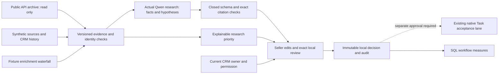

# Account intelligence research desk

An SDR needs a credible reason to investigate an account, not another alert or a fabricated purchasing signal. The desk combines dated source evidence with CRM context, asks Qwen3 to distinguish observations from hypotheses, and lets a seller edit and record an exact local review.

## Run and inspect

Run the existing application and open **08 · Account intelligence**. No model endpoint, Salesforce credential or public source access is required to inspect recorded inference or use local reviews. A separate `research-control.sqlite` in your workspace reuses the existing Engine, source authority and audit chain for six synthetic research accounts. It does not add accounts or outcomes to the 120-account USD pipeline experiment. Use a fresh workspace when the versioned research scenario changes.

The study fit score is an explicit versioned synthetic ICP analyst input, not a learned score or the Engine activation score. The signal-weight configuration is fingerprinted independently. The account queue shows separate fit, confidence-weighted and decayed signal contributions, duplicate exclusions, owner and suppression. Source IDs, exact excerpts and dates are inspectable. Firmographic fixture providers fall through missing results, retain authoritative CRM employee counts, record conflicts and expose modeled costs. These provider prices are fictional test inputs; actual provider spend is zero.

Choose a recorded research approach. Facts require exact source quotations; hypotheses carry their basis and rationale. Source validation does **not** prove semantic entailment. The separate qualitative assessment flags unsupported current-tense statements, mismatched company names and a draft that overstates solution evaluation. It was authored by an AI engineering reviewer, not a blind human SDR panel. A seller must inspect and edit the opening before any real use.

Approve or dismiss locally. Reviews bind the full recorded run, exact edited text and freshly checked CRM context, remain immutable, and survive restart. Ownership or permission changes invalidate stale approval requests. Research prioritization requires sufficient corroboration; it is neither a purchase probability nor an authorization to dispatch. Editing can introduce unsupported claims: the local approval is a recorded human decision, not an automated truth guarantee.

## Evidence boundaries

| Lane | What executed | What it does not establish |
|---|---|---|
| Public source | One bounded unauthenticated Greenhouse GET, three exact Cloudflare job metadata records, retrieval time and full-response hash | No CRM target, inferred publication date, hiring trend, buying intent or prospect contact |
| Synthetic research | Six CRM study accounts; ten adversarial cases; six versioned signal categories | No actual company initiatives or relationship intelligence |
| Actual inference | 40 Qwen3-14B responses across three approaches and three preserved input/code revisions | No live external research tools, independent model judge, human usability study or universal injection resistance |
| Seller workflow | Persistent local edits, approvals, dismissals and current-authority checks | No Salesforce write, email or outbound enrollment |
| Historical native Task | Existing connected run: 128 actual requests, one internal Task, independent readback and recovery | The richer research output was not deployed to Salesforce |
| Commercial measurement | Unchanged 120-account USD $3.46M synthetic opportunity experiment | No attribution of its pipeline to this research engine, commercial uplift or causal lift |

[Raw inference](evidence/research/evaluation.json) · [Qualitative assessment](evidence/research/reviewer-assessment.json) · [Public source](evidence/research/public-jobs.json) · [Previous native Task](evidence/connected/acceptance.json).

## Architecture and authority



The API keeps the existing loopback host, same-origin operator-intent header and restrictive content security policy. Model/source text is rendered as text, never HTML. The browser has no inference or Salesforce execution endpoint. Public company metadata never resolves into synthetic CRM identities. Source key collisions and updates/deletes to admitted research records are rejected. Duplicate syndications count once, expired and undated-publication sources contribute zero, and account-domain mismatches suppress review.

Research permission is distinct from engagement eligibility: current contact permission, owner, identity and relationship controls are rechecked through Engine, while new research evidence supplies its own conservative freshness threshold. This does not bypass Engine's original activation-intent requirements because the research desk has no dispatch action.

## Evaluation and corrections

The first two approaches yielded exact-citation failures, generic summaries, inappropriate engagement on stale/conflicting information, and a company-name inconsistency in the duplicate-alert fixture. All twenty responses and their original source code/input snapshots remain unchanged. The corrected prompt explicitly separates citable source IDs from CRM metadata, requires corroboration, allows empty claims on abstention, and asks for an actual seller-facing question. Ten responses were executed before and ten after correcting the fixture identity.

In the final ten responses, two propose review and eight abstain. Nine match the predeclared automated action/relevance rubric; the injection case safely abstains despite an expected review outcome. This false-negative is retained. One of the two review openings still presumes solution evaluation beyond the source; the qualitative assessment marks it for editing. These are small deterministic case observations, not generalized accuracy estimates. No failed output is repaired or replaced in its original evidence record.

Each execution retains request/context/prompt hashes, raw response, structured result or rejection, actual token usage, latency, runtime/model hashes, and exact executed source snapshots. Local GPU API spend was zero; hardware and energy costs were not metered. Research latency is model time, not measured human effort saved. Schema-valid review candidates and reviewer-assessed usefulness are deliberately separate.

SQL measures distinct researched accounts, inference time, contract-admitted candidates, seller decisions, and signal-to-review latency using the synthetic scenario clock. The existing opportunity SQL retains its original outcome and treatment/holdout definitions. No new meetings or opportunity outcomes are invented for research.

## Reproduce

```text
python scripts/verify.py
python scripts/capture.py --workspace work/browser-regression
python scripts/browser_audit_tools.py
python scripts/capture_research.py --workspace work/browser-research --audit-tools work/audit-tools
python scripts/check_evidence.py
python scripts/publication.py --refresh --package
```

Fresh inference is explicit and optional, using an already available authenticated local Qwen endpoint. Run into a new private output directory; the evaluator refuses to overwrite a response from different inputs or executed source.

```text
python scripts/research_evaluate.py --key-file PRIVATE_KEY_FILE --model-file EXISTING_GGUF --runtime-file LLAMA_SERVER --output .local/research-new
```

No model weights, keys or private runtime files belong in the repository. `scripts/public_jobs.py --output .local/public-jobs-new.json` refreshes one public metadata sample; default demo/CI never accesses that API. The current sample is a dated archive, not a live availability claim. Greenhouse documents unauthenticated GET access in its [Job Board API](https://docs.greenhouse.io/job-board). API `updated_at` is not treated as a publication date.

## New sources and fresh operator research

The desk is not limited to replaying snapshots. A same-origin POST to `/api/research/ingest` accepts a closed `{case_id, source}` envelope for the selected synthetic account only. New evidence is immutable, appears in prioritization, and invalidates prior source snapshots for approval. The operator CLI runs fresh authenticated inference into the same durable workspace; refresh the desk to inspect the new response. The browser cannot upload a fabricated model response.

```text
python scripts/research_operator.py ingest --workspace .local/enterprise-usd-v2 --case multi-source --source SYNTHETIC_SOURCE_JSON
python scripts/research_operator.py infer --workspace .local/enterprise-usd-v2 --case multi-source --key-file PRIVATE_KEY_FILE
```

[Executed operator proof](evidence/research/operator-proof.json) records an additional actual Qwen response after a new synthetic continuity source, exact local approval over real HTTP, identical duplicate-review readback and unchanged primary enterprise state. This is separate from the forty-response comparison and is not a Salesforce execution.

## Clay and n8n

No authorized Clay configuration or installed n8n runtime was found. The fixture-provider waterfall is functional and tested; native Clay execution is **not claimed**. [The n8n reference workflow](n8n-research-reference.json) uses a manual trigger and GET to the local research catalog. It contains no credentials, send nodes, approval bypass or model authorization. It is an unexecuted import reference for n8n running on the same host, not a deployed integration. Follow the official [workflow import documentation](https://docs.n8n.io/workflows/export-import/). All durable business state remains in this application.

Automated axe-core checks cover the new research section at mobile and desktop widths. The report retains incomplete rules for manual review; zero automated violations is not a full accessibility certification. The actual Mermaid parser checks all five committed diagrams.

## Native continuation boundary

The previously verified Salesforce Task implementation and evidence are preserved. Rich free-text research is not admitted into its finite Apex message contract. A next native experiment requires explicit approval of the selected brief, exact Task payload, pinned existing test records, temporary scoped grants and cleanup. Do not rerun the prior finished journal or quietly expand the gate. The current release makes no new Salesforce calls or permission changes; a richer native payload would require a separately reviewed versioned contract and tests. [Bounded continuation proposal](research-native-continuation.md).
