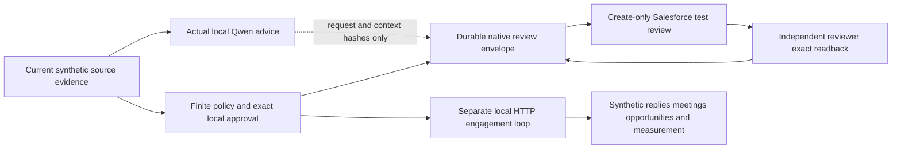
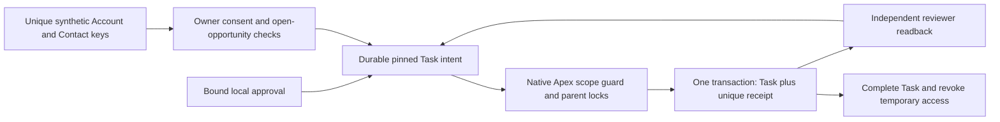

# Architecture and trust boundaries

## Small deployment, distinct responsibilities

FastAPI serves a local operator UI. Python applies source contracts, identity, scoring, allocation and review policy. SQLite WAL stores durable control state. A separate authenticated HTTP destination owns a different SQLite file containing immutable-key enrollments, exact-content receipts, feedback and a request journal. The default launcher runs that server in a separate thread; it is a separate data/HTTP boundary, **not a separate host, process or security principal**. Process-death tests kill only a dispatch subprocess while the receiver remains alive.

The deployment is intentionally single-host and synthetic-only. `BEGIN IMMEDIATE` serializes admission and holds the local authority lock across a bounded network request. This trades throughput for an understandable consent/ownership boundary. It is not a distributed transaction with a live CRM. A production integration would need authenticated source identities, operational freshness SLAs, a scalable durable store and separately operated receiver infrastructure.

## Identity and source ownership

`source/v1` requires source, immutable event ID, brand, observed time, domain and a closed per-kind field vocabulary. The deduplication key is `(source, brand, source_id)`. Reusing a key with different content fails. Sources and their disposition are append-only.

Accounts are scoped to an operating unit. Discovery from enrichment remains unverified until CRM confirmation. Separate trusted CRM record IDs sharing a domain stay distinct. Without an explicit valid account reference, multiple domain matches quarantine an inbound request. Even explicit reference matching does not promote unresolved same-brand/domain duplicates into the experiment. Cross-brand references fail. Contacts must use the account's synthetic domain; changing the contact requires review.

CRM controls owner, lifecycle, contact and authoritative fit fields. Enrichment may populate missing fit attributes but cannot overwrite a CRM value or establish ownership/consent. A conflict is audited. Out-of-order owner updates cannot regress the current owner. Late opt-out suppresses; stale opt-in cannot restore permission. Source identities in this local demonstration are trusted operator inputs, **not authenticated vendor attestations**.

## Qualification and routing

[The pinned policy](../src/gtm/policy.json) separately scores employee fit, industry and territory, then decays intent over 30 days. Repeated records of the same signal type contribute only their strongest current value. CRM facts and ownership have a 365-day maximum age; enrichment facts expire after 30 days. Stale authoritative CRM fields do not silently fall back to a conflicting enrichment value.

Every qualification record retains the policy hash, contributing source keys, freshness verdicts and exclusion reasons. The cohort admission rechecks its decision under the mutation lock. Inbound requests preserve valid existing owners and route customers/support inquiries to service review. New-business inquiries create a durable seller-review route or named exception. These records are the local CRM review queue; external CRM Task creation is not implied.

## Advice, approval and dispatch

The default research view deterministically indexes actual account evidence. Optional local-model requests use a closed advisory JSON response with exact source quotation checks. No model method has dispatch, approval or downstream credentials. Quotes can be exact yet unsupported in context; no general semantic-grounding claim is made.

Executable `action/v1` content comes from a finite neutral sequence. A trusted local reviewer approves the exact account, brand, owner, contact, content hash, scoring context and experiment. SQL triggers prevent approved-content mutation. New dispatch rechecks current owner, contact permission, account eligibility, policy, selected evidence, experiment window and approval age. Arbitrary personalization remains advisory. The finite sequence is deliberately less expressive than free-form outbound copy.

A persisted attempt precedes the HTTP write. The worker reads all independent receipts and checks recovery consistency, then looks up the action receipt before deciding whether another POST is allowed. Receipt matching checks full payload, hash, action key, receipt identity and timestamp. A found effect can reconcile after opt-out or expiry without initiating a new action. Backoff and write budgets survive worker replacement. A receiver conflict or policy denial is retained as a terminal exception.

## Measurement and lineage

Feedback retains source key, account, action (when sequence-originated), business ID, parent transition, creation time, outcome time and received time. Sequence meetings require a prior positive reply; accepted sequence opportunities require the recorded qualified meeting. Organic holdout outcomes are admitted from synthetic CRM/engagement sources without inventing enrollment.

The account mart aggregates meeting and opportunity grains separately before joining cohorts, preventing a meeting/opportunity fanout. SQL outputs and a separate Python traversal are compared in regression tests. [Measurement contract](measurement.md).

## Security boundary

- Default services bind to loopback. The browser rejects unapproved Host and cross-origin mutations, requires an operator-intent header, applies a strict CSP and renders source text without HTML interpretation.
- Receiver tokens are randomly generated in memory. They do not enter the browser, evidence, package or repository. There are no CRM credentials in the core.
- Destinations and optional models are constrained to bare loopback HTTP origins; redirects are disabled. Only `.example`, `.test` and `.invalid` source domains enter the system.
- The UI's `demo-reviewer` is a **trusted local operator label**, not enterprise login or authorization. Do not expose the service publicly or load client data.
- Hashes and append-only triggers detect ordinary mutation and bind evidence; a host/database administrator is trusted. They are not a signature authority, WORM service or defense against that administrator.

The container permits a bind inside its network namespace only so Compose can publish **127.0.0.1:8560**. Changing this to public hosting requires a different authentication and deployment design.

## Separate native review boundary

The explicit Salesforce acceptance runner uses an approved test-org pin, CLI-managed credentials, read-only administrator preflight, a create-only integration identity and an independent reviewer. A separate durable `crm_reviews` table binds the exact local approval to destination identity, synthetic alias mapping and advisory reference. It never writes a native receipt into the local engagement journal or counts a review as a pipeline outcome. Native exact-content lookup happens before new-action authorization, preserving historical reconciliation after opt-out. Current authorization and native synthetic owner/source are rechecked before each bounded new create. Existing immutable content cannot be overwritten by an upsert.

The UI exposes three fixed sanitized evidence artifacts through GET; it has no Salesforce write or inference route. Native/model provenance is pinned to its executed Git revision, while fresh browser and regression reports bind current code. The [historical operator procedure](native-ai.md) preserves the earlier custom-review/model boundary.

## Native standard-object boundary

The [standard CRM lane](native-standard-crm.md) adds unique run-scoped Account/Contact resolution, exact owner/relationship/consent checks and a separate `crm_tasks` journal. A finite internal Task envelope references the pinned native records; model prose has no write authority. Parent locks and a server-side Apex guard recheck synthetic scope and open opportunities. A unique immutable receipt is inserted in the same transaction as the Task: duplicate receipt failure rolls back the extra Task. The independent reviewer reads both the Task and its exact receipt, rather than trusting the POST response.

Setup uses explicit isolated administrator authorization for metadata, temporary assignments and newly created synthetic records. Original profiles, custom-review grants and sharing defaults remain unchanged. Source objects and receipts are API read-only for the writer. Task creation requires activity permissions; the Apex guard restricts the broader system permission to marked synthetic insertions and blocks writer mutations. The read grants do not establish row isolation in an org with broad Account/Contact/Opportunity sharing defaults. Only exact test records are queried. Other Salesforce writers need not obey the parent-lock protocol, so cross-system races remain a stated limitation.

## Commercial profiles

`--profile fixture` retains the original small deterministic source replay. `--profile enterprise` creates a separate 120-account B2B fixture from versioned segmentation and commercial scope assumptions. Workspace profile identity is persisted; existing data is never silently revalued or rebuilt. Both use the same `Engine`, `Worker`, independent destination, outcome contracts and `pipeline.sql`.

Enterprise amounts are integer-cent annual opportunity estimates in actual synthetic CRM outcome records. A separate Python traversal of source events verifies counts, cohort/time cutoffs and amount totals against SQL and independently rereads CRM feedback through HTTP. The UI displays SQL totals and source-record line items; it contains no hardcoded enterprise pipeline total. Segment labels derive from CRM employee counts and do not override qualification or assignment. The larger scenario does not inherit a native/model execution claim from the earlier small fixture. [Assumptions, evidence and reproduction](evidence/enterprise-usd/README.md).

The featured enterprise v2 currency and locale are pinned from the versioned scenario before source generation. All enterprise outcomes carry that denomination; admission, SQL and independent reconciliation reject mismatches. API and browser labels derive from the same snapshot. Existing CAD enterprise workspaces require a fresh directory, so existing amounts cannot acquire a new currency label. The archived small fixture retains its original implicit CAD contract and complete output.

## Connected signal-to-SDR execution

The opt-in [connected lane](connected-sdr.md) adds versioned synthetic job-source admission, actual CRM-context inference and exact-review binding to the existing engine and native Task dispatcher. Its finite versioned envelope carries source/model/review digests and a reviewed question; the old fixed-message contract is unchanged. Apex rejects arbitrary personalization and rechecks current synthetic scope and ownership. Separate reviewer readback checks the entire Task and atomic receipt. The executed continuation is linked to its immutable pre-approval model preview; the older native/model evaluations and enterprise outcome scenario remain separate evidence sets.
