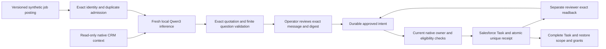

# Buying signal to verified internal SDR Task

An SDR needs a relevant reason to review an account, an accountable owner and confidence that uncertain API responses will not create duplicate work. This lane connects a **fresh Qwen3 response to one actual Salesforce Developer Edition Task**, using fictional source content and an existing, explicitly pinned synthetic Account/Contact pair.

It does not send outreach. The suggested question is a draft for internal review, not a delivered communication or a buying commitment.

## What executed

1. Six authenticated, read-only Salesforce requests checked the existing Account, Contact, owner relationship and absence of open opportunities. Restored field permissions hid the custom activation and opt-out fields; the model context explicitly records that limitation.
2. A versioned synthetic infrastructure job posting was ingested once. Its repeated event was recognized as a duplicate. It contributes the existing conservative **research** intent signal, not pricing intent. The separate 240-employee/software fit inputs are synthetic scenario assumptions.
3. A fresh local **Qwen3-14B Q4_K_M** response selected an exact source quotation and a planning question from a finite catalog. The recorded request includes the actual read-only CRM context. No earlier evaluation response was substituted.
4. The operator approved the exact review digest. Temporary, existing scoped test grants exposed the remaining fields. Execution reverified the unique CRM keys, current owner, contact association, active scope, eligibility and absence of an open opportunity before writing.
5. **128 authenticated REST requests** exercised the native continuation. One Task committed with the reviewed message and signal/model/review hashes. The client then deliberately discarded its successful acknowledgement. A fresh dispatcher instance independently read the exact Task and immutable receipt through the reviewer identity, without a recovery POST.
6. Duplicate insertion rolled back. Unsupported personalization, changed ownership, revoked eligibility and reviewer creation were rejected and checked for absent effects. Historical receipt reconciliation still worked after eligibility was revoked.
7. The new Task was completed; the original Account/Contact flags were restored to disabled/opted-out. Four temporary assignments were removed and the original permission/license assignment sets were verified. Five native Apex tests passed. No earlier Task or opportunity was adopted for mutation.

[Fresh inference and source context](evidence/connected/preview.json) · [Native continuation](evidence/connected/acceptance.json) · [Actual Apex results](evidence/connected/apex.json) · [Offline lineage verifier](../scripts/check_connected.py)

A subsequent safety review tightened the server guard to reject a changed **Contact owner** under the same row lock. The separate [native Apex rerun](evidence/connected/apex-owner-hardening.json) passed all five tests, including that rejection. The 128-request run stays pinned to its [original execution revision](evidence/connected/execution-source.json); no persistent Task was replayed to make the later code look executed. A [fresh GET-only cleanup check](evidence/connected/post-cleanup.json) verifies original assignments, both old/new Task contents and the unchanged closed-lost opportunity.

The preview retains `native_task: not_executed`: it is the immutable **pre-approval** observation. The separate continuation record proves the later write by binding the exact preview, model and review digests. It is not a contradictory status or an overwritten forecast.

## Execution architecture



`gtm.connected` extends the existing engine and `TaskDispatcher`; it does not introduce a second orchestration engine. A `gtm-connected-v1` envelope adds four fields to the original eight-field contract: signal, model and review digests plus a finite question identifier. The original `gtm-standard-v1` content restriction is preserved. Apex independently accepts only the two bounded message variants, checks current synthetic scope/ownership/eligibility under row locks, and atomically creates the unique immutable receipt.

The model cannot authorize itself, choose an owner, change a contact, call Salesforce or send a message. Its output is deliberately constrained extraction and question selection, **not unrestricted account research or general semantic verification**. Arbitrary prose fails validation even if it sounds plausible. Hash fields bind content; their presence alone is not an authorization decision. Local reviewed intent, current native checks, scoped identity and server-side validation remain required.

The local engine's `review_clock` freezes the exact qualification decision for review; its approval audit timestamp is that logical clock, not a claim about the operator's wall-clock click time. Native request timestamps and the [actual deployment timestamps](evidence/connected/apex-deployment-provenance.json) record external execution. Dispatch rechecks current authorization and the approval age.

## Failure boundaries

| Condition | Executed proof |
|---|---|
| Unsupported personalization | Local contract rejection and actual native Apex/REST rejection |
| Ambiguous brand/domain identity | Local negative test; no claim of a newly created ambiguous native Account |
| Changed CRM owner / revoked contact eligibility | Actual native client and server rejection; original state restored |
| Repeated job source | Actual connected ingestion returns duplicate; one derived intent |
| Transport timeout / retry exhaustion | Local software fault tests; three durable attempts and backoff |
| Acknowledgement lost after commit | Actual Salesforce 201 observed privately, then discarded by the client fault harness; independent recovery without repost |
| Duplicate action | Actual native duplicate transaction rejected; exactly one Task/receipt verified |
| Reviewer create permission | Effective `createable=false` checked separately from the rejected POST |

No real network outage is claimed: the lost acknowledgement is an intentional client fault **after an actual native commit**. Pure transport-timeout tests use mock transport and are labeled local.

The native recovery probe creates a new dispatcher instance in the same controller process against durable intent. OS process-death recovery is exercised separately by the existing local regression tests; this native probe does not claim to kill and restart an operating-system process.

## Reproduce without credentials

```text
python -m pytest
python scripts/check_connected.py
python scripts/verify.py
python scripts/capture.py --workspace .local/browser-connected
python scripts/check_evidence.py
python scripts/publication.py --package
```

The browser reads committed, sanitized evidence. It does not need Salesforce credentials, weights or an inference server to inspect this run. The normal enterprise demo remains the independent local USD scenario; it does not execute this native lane.

Historical lineage checks require a full Git clone so the pinned executed source can be inspected. A source ZIP can still run the core tests, local demos and browser reproduction.

## Authorized native reproduction

Native reproduction is optional and requires the existing pinned Developer Edition/sandbox, three separate authenticated identities, an exact private retained-record manifest, deployed scoped metadata and an approved local model endpoint. Never use production or substitute arbitrary CRM records. The preparation command is read-only against Salesforce; its fresh inference preserves invalid responses rather than silently replacing them.

Run `scripts/connected_prepare.py --help` with the private configuration, finished retained manifest, new private workspace, existing Salesforce CLI, private model token file, runtime and weights. Review `preview.json` and the proposed temporary activation of those exact synthetic records. Do not publish its adjacent private scope or database.

Only after exact-content approval, deploy `GTMTaskGate` and `GTMConnectedGateTest` from the Salesforce project and run both `GTMTaskGateTest` and `GTMConnectedGateTest`. The bounded continuation requires `--approved-isolated-writes` and the exact `--approved-review-sha256`. It refuses a changed digest or an already finished run, journals temporary grants, verifies the disabled/opted-out baseline, and always attempts cleanup. An uncompleted run must be investigated from its private journal; do not rename it to evade a failed check.

`scripts/connected_postcheck.py` performs a fresh, GET-only check of restored assignments and old/new Task contents. Final scope-flag readback occurs before permission retirement; afterward FLS intentionally hides those fields again. Never weaken FLS to make a cleanup report look more complete.

## Relation to the portfolio

The earlier 16-response Qwen evaluation, 140-request standard-object acceptance and USD $3.46M enterprise pipeline scenario remain byte-for-byte historical evidence. This new lane is a **single connected model-to-Task execution**, not a claim that the 120-account pipeline scenario ran through a live vendor stack. No meeting, opportunity, customer win or revenue was generated by this Task.

For the Evidence Lab, add a recorded **Connected signal-to-SDR handoff** case next to its existing three GTM evidence sets, importing this preview, continuation, cleanup and Apex records with pinned source hashes. Show the live association only within this new run. Keep the USD pipeline comparison explicitly separate. This is a proposed Lab enhancement; this change does not modify or deploy the Lab.
